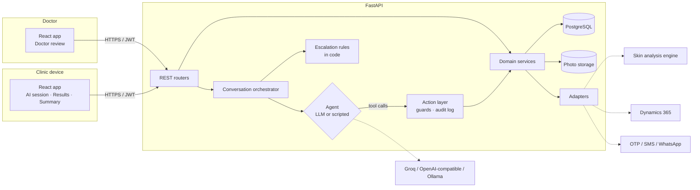
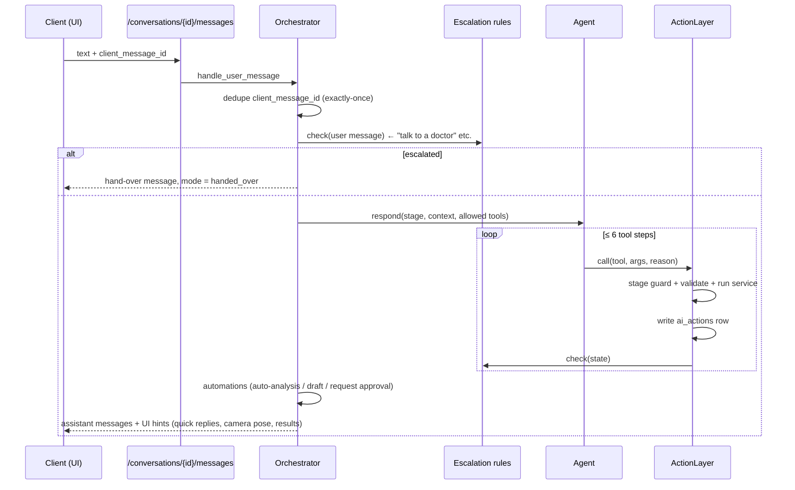
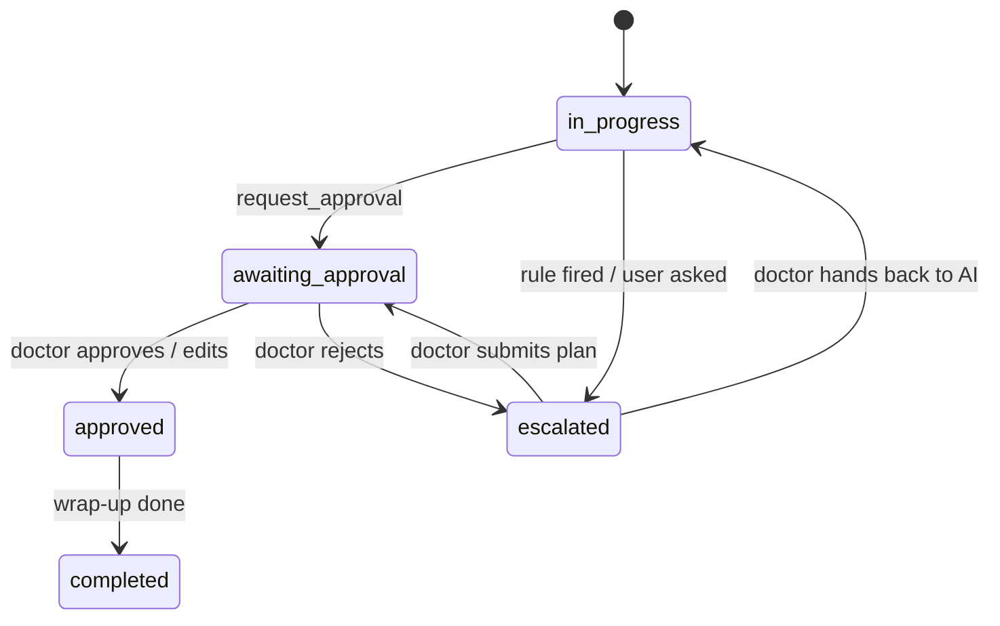

# 02 · Architecture and Design

## 1. System context



## 2. Key design decisions

| # | Decision | Why |
|---|---|---|
| D1 | **The stage is derived from data, not stored.** `compute_stage()` reads the conversation, visit, assessment, photos, analysis, prescription and approval, and returns one of: `identify → concern → assess → capture → analyse → recommend → approval → booking → wrap_up → done`, or `handed_over`. `booking` lasts while approved treatments still need a room | The AI can't skip a step by claiming it's done. Restarting a session resumes in the right place |
| D2 | **Tools are gated by stage.** The agent only sees the tools allowed in the current stage, and the action layer checks again | An LLM mistake can't jump ahead, for example drafting a prescription before analysis |
| D3 | **One action layer.** Every tool, whether called by the LLM, the scripted agent or a code automation, goes through `ActionLayer.call()`. That call checks the stage, validates the arguments, runs the service, writes an `ai_actions` row and re-checks escalation rules | Covers NFR-02 and NFR-04 in one place |
| D4 | **Deterministic steps are automated in code.** Analysis runs as soon as the photos pass. Drafting runs as soon as analysis is done. Approval is requested as soon as a draft passes safety checks | The spec says the AI "completes the visit on its own". The LLM is used for language, not sequencing |
| D5 | **Two agents behind one interface.** `LLMAgent` does OpenAI-compatible tool calling (Groq by default). `ScriptedAgent` is a rule-based fallback for offline demos and tests | The app works end-to-end without a key, and tests are deterministic |
| D6 | **Catalogue-only recommendations.** The recommendation engine selects from `catalogue_items`. `draft_prescription` rejects any ID that isn't in the catalogue | §04: "never makes up a service, product or diagnosis" |
| D8 | **Conversational layer with guard rails.** On each typed reply the LLM sees the client's memory: name, age, today's concern in their own words, answers so far, previous visits and plans, and the last note. It returns `{intent, value, reply}`, and code acts on that decision. It saves an answer only to the current question and only with a valid option. It hands over only on an explicit request or a medical problem. It then adds the next question verbatim. Identity and OTP, tapped options, and all photo progress stay in code. Injuries (burn, bleeding, infection, swelling, fever…) are also caught by a code rule | Live testing showed that a purely tool-calling model guessed answers and claimed photos were taken, while a purely scripted flow felt robotic and forgot context |
| D9 | **Treatment-room availability is computed, not stored as slots.** Rooms have capabilities, hours and a turnover buffer; free slots are worked out from bookings and blocks on request. Offers are spread across the day (at most one per morning, afternoon and evening) so the client has a real choice. Booking locks the room row and re-checks, and a Postgres exclusion constraint is the last line of defence. Slot times are only ever stated by code; the LLM can say which offered slot the client meant, or which day they'd like, but never that a time is booked | No slot table to keep in sync when hours, buffers or blocks change; double booking is impossible even under concurrent requests |
| D11 | **One rule check for rooms, doctors and machines** (`services/ot.evaluate`), used both to offer slots (only slots with no problem at all) and to book or move one. Rules are hard (overlaps, blocks, leave, no machine, unsuitable room, past) or soft (outside hours, holiday, doctor off shift); staff may override soft rules with a recorded reason. Unnamed doctors and machines are picked automatically. Postgres exclusion constraints guard each of room, doctor and machine for tentative and confirmed bookings. Each booking has a `version`; changes quote it (optimistic concurrency) | The chat and the staff calendar can never disagree about what is free; a race or a stale screen can't double-book or overwrite a colleague's change |
| D10 | **Follow-up chats are separate threads, not reopened consultations.** A `threads` row per client and past visit (plus one general) with its own messages; the consultation state machine is untouched. Who answers is decided in code: `mode=ai` → the follow-up assistant (`ai/followup.py`) with facts from `client_history` (approved data only); `mode=staff` → the clinic team. Symptoms and requests for a person are detected in code before the model sees the message. Clients on their phone get their own JWT (`role=client`, 7 days), rejected by every staff route | Old visits stay as signed off; a manipulated model can't change plans or bookings or avoid hand-over; client and staff tokens can't be mixed up |
| D7 | **Adapters for external systems.** Analysis, D365, OTP, messaging and storage each have an interface plus a mock. The real implementation is chosen by env | External services aren't available yet (see 01 §5) |

## 3. Backend layout

```
backend/app
├── main.py              FastAPI app, middleware (no-store, request id), routers
├── config.py            Settings from env (pydantic-settings)
├── db.py                Async SQLAlchemy engine/session
├── models.py            ORM: data model in 04-data-model.md
├── schemas.py           Pydantic request/response models
├── security.py          JWT, bcrypt, role guards
├── logging_setup.py     Redacting log filter (NFR-06)
├── idempotency.py       Idempotency-Key store (NFR-07)
├── api/                 Routers: auth, clients, visits, photos, conversations, doctor, catalogue, public, admin
├── services/            Domain logic: clients, visits, assessment, photos, analysis, recommendations,
│                        prescriptions, approvals, escalation, notes, summary, otp, stage
├── ai/
│   ├── tools.py         Tool specs (JSON schema) + ActionLayer
│   ├── agents.py        LLMAgent + ScriptedAgent
│   ├── providers.py     OpenAI-compatible chat client (Groq / OpenAI / Ollama)
│   ├── prompts.py       System prompt builder
│   └── orchestrator.py  Turn handling, automations, events (approval decided, doctor joined)
├── integrations/        analysis_engine, skin_models (WebSocket), d365, messaging, otp_sender, storage (each: interface + mock)
└── knowledge/           questionnaire.json, catalogue.json, rules.json (versioned clinic knowledge)
```

## 4. A conversation turn



## 5. Visit and prescription state machines



Prescription: `draft → pending_approval → approved | rejected`. Editing after rejection creates version n+1.

## 6. Frontend

- Vite, React 18 and TypeScript, with React Router.
- No state library. Server state is fetched per screen, and state is held in memory only (NFR-06).
- **AI session** has an avatar panel (with a slot for the real-time avatar stream) and live captions. Voice uses the Web Speech API: `SpeechRecognition` for input and `speechSynthesis` for output, en-IN. It also has a text box, quick-reply chips and an in-session camera with pose guidance.
- **Results** shows photos, findings with severity bars and the draft plan, marked as a draft.
- **Summary** shows the approved plan and next session. The public share link uses the same view.
- **Doctor review** has a queue (drafts, escalations and clients waiting in a chat), Messages, Records and a visit detail page: transcript, photos, findings, editable plan and action log. Actions are approve, edit, reject, take over and hand back. Messages lists every follow-up chat; New message starts one with any client, and each visit has a Message client button.
- **History** (clinic device, after OTP) and **/my** (client's phone, mobile + OTP) show the client's own consultations, upcoming treatments and chats with the clinic, from one shared component.

## 7. Deployment

`docker-compose.yml` runs three containers:
- `db`: postgres:16
- `api`: uvicorn, with Alembic migrations on start
- `web`: nginx, serving the built React app and proxying `/api` to `api`

TLS ends at nginx or an upstream load balancer. Photos go to a named volume; use the S3 adapter in production.
