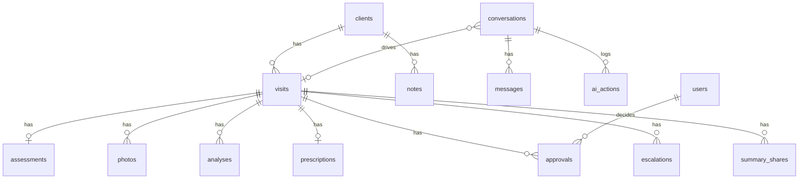

# 03 · Data Model

PostgreSQL 16. The schema is managed by Alembic (`backend/alembic/versions/`), and the ORM lives in `backend/app/models.py`.

## Visit-based model (from today's app)

| Table | Key fields | Notes |
|---|---|---|
| `clients` | `mobile` (E.164, unique), `full_name`, `dob`, `gender`, `external_ref`, `source` | `source` is `local`, `d365` or `ai` (created in conversation) |
| `visits` | `programme` (the service: `acne`, `pigmentation`, `age`, `skin`, `anti_aging`, `medical`; session 2 onwards is its follow-up), `session_number`, `status`, `concern_text`, `concerns[]`, `next_session_date` | Status is one of `in_progress`, `awaiting_approval`, `approved`, `escalated` or `completed` |
| `assessments` | `answers` (JSONB), `skipped` (JSONB), `skin_type`, `sensitive`, `flags` (JSONB), `completed` | `flags` holds pregnancy, `medication_tags`, `allergy_tags` and questionnaire concerns |
| `photos` | `pose`, `storage_key`, `quality` (JSONB), `accepted` | The image bytes are kept in storage, not in the DB |
| `analyses` | `kind` (`diagnosis`, `anti_aging` or `compare`), `engine`, `result`, `confidence` | `compare` stores the change for each concern against the previous visit |
| `prescriptions` | `status`, `items` (JSONB), `safety` (JSONB), `rationale`, `version` | Items are copies of catalogue rows at drafting time |
| `notes` | `author_type` (`ai` or `staff`), `text`, `tags[]` | |

## AI additions (spec §09)

| Table | Spec entity | Key fields |
|---|---|---|
| `conversations` | Conversation | `visit_id`, `language`, `mode` (`ai`, `handed_over` or `closed`), `consent_at`, `consent_recording_at`, `context` |
| `messages` | Conversation.transcript | `seq`, `role` (`user`, `assistant`, `doctor` or `system`), `content`, `client_message_id` (unique per conversation) |
| `ai_actions` | AIAction | `action`, `actor` (`ai`, `automation` or `staff`), `inputs`, `result`, `reason`, `status` (`ok`, `blocked` or `error`), `stage` |
| `approvals` | Approval | `prescription_version`, `doctor_id`, `status` (`pending`, `approved`, `edited` or `rejected`), `notes`, `decided_at` |
| `escalations` | Escalation | `trigger`, `details`, `assigned_doctor_id`, `status` (`open`, `in_progress` or `resolved`) |

| `threads` | Follow-up chat (FR-21) | `client_id`, `visit_id` (NULL = general; one per client and visit), `mode` (`ai` or `staff`), `waiting_since` (client awaits staff), `handover_reason`, `assigned_user_id`, `last_seq`, `client_read_seq`, `staff_read_seq`, `client_notified_seq` |
| `thread_messages` | Follow-up chat messages | `seq` (unique per thread), `role` (`client`, `assistant`, `staff` or `system`), `content`, `meta` (author, author role, channel), `client_message_id` (unique per thread) |

The spec puts the transcript in one field. Here it is stored as ordered `messages` rows instead. That way a duplicate submission can be rejected with a unique key (NFR-07), and doctors can post into the same conversation.

## Clinic knowledge and infrastructure

| Table or file | Purpose |
|---|---|
| `catalogue_items` | Services, products and doctor services, with concerns, suitable skin types, contraindication tags, ingredients, sessions, interval and price. Clinic treatments also have `room_type` (the kind of room they need: `laser`, `led`, `peel`, `facial`, `minor_procedure`) and `duration_min`. Seeded from `knowledge/catalogue.json` |
| `ot_rooms` | Treatment (OT) rooms: `code`, `name`, `capabilities[]` (room types it can host), `open_time`, `close_time`, `open_days[]` (0 = Monday), `buffer_minutes` (turnover), `active`. Three demo rooms are seeded |
| `ot_blocks` | Time a room (maintenance), a doctor (leave) or a machine (servicing) can't be used: exactly one of `room_id`, `user_id`, `equipment_id`, plus `starts_at`, `ends_at`, `reason` |
| `ot_equipment` | Machines: `code`, `name`, `equipment_type` (matched to `catalogue_items.equipment_type`), `buffer_minutes` (cool-down or sterilisation), `active` (out of service when false). Four demo machines are seeded |
| `doctor_hours` | Doctors' weekly working hours: `user_id`, `weekday` (0 = Monday), `start_time`, `end_time`; several rows a day allow split shifts |
| `clinic_holidays` | Closed days: `day`, `name` |
| `ot_readiness_items` | Pre-treatment checklist per booking: `key`, `label`, `mandatory`, `status` (`pending`, `done`, `not_applicable` or `blocked`), `note`, who and when |
| `ot_bookings` | A plan treatment booked into a room: `visit_id`, `catalogue_item_id`, `session_index`/`sessions_total`, `status` (`tentative`, `confirmed`, `deferred` or `cancelled`), `room_id`, `starts_at`, `ends_at`, `clear_until` (end + turnover), `source` (`ai` or `staff`), `doctor_id`, `equipment_id`, `equipment_clear_until` (end + machine buffer), `confirmed_at`/`confirmed_by_user_id`, `stage` (`scheduled`, `checked_in`, `in_progress`, `completed` or `no_show`) with `checked_in_at`, `started_at`, `finished_at`, `override_reason` and `overridden_rules`, and `version`. Three exclusion constraints (`btree_gist`) stop tentative or confirmed bookings overlapping on the same room, doctor or machine, and a partial unique index allows one live booking per treatment session. `catalogue_items` gains `equipment_type` and `needs_doctor` |
| `knowledge/questionnaire.json` | The 18 *Know your Skin* questions. Each option carries scoring (`oil`, `combo`, `sens`), a concern or a safety flag |
| `knowledge/rules.json` | Services (Scriptions, Anti Aging, Medical Consultation, follow-up names) and how they are picked, concern keywords, recommendation limits, medication-conflict and allergy keyword lists, and phrases that mean "I want a person" |
| `otp_challenges` | HMAC of the code, expiry and attempt count. The code itself is never stored |
| `summary_shares` | Expiring token for the client's summary link and the masked destination |
| `idempotency_keys` | The stored response for each `Idempotency-Key` |

## Personal and health data

| Data | Where | Protection |
|---|---|---|
| Mobile number | `clients.mobile` | Transcript lines keep the last 4 digits only. Logs are redacted |
| OTP | Never stored | HMAC only, and masked in the transcript |
| Health answers, photos, analysis | Postgres and photo storage | Server only. The browser keeps them in memory; responses are `no-store` |
| Audit log | `ai_actions` | Inputs are kept for accountability. Photo bytes are logged as a size only |
